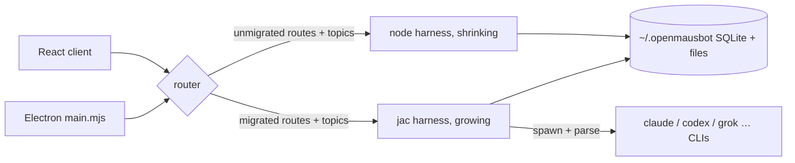

# Migrating ngai-platform to a Jac codebase

Date: 2026-10-07. Base: `main` @ 63d0ef3. Branch: `jac/codebase-migration`.

Status: **phase 0 complete — GO**. **Execution plan from 2026-10-10:**
`docs/plans/2026-10-10-jac-implementation-plan.md` (workstreams, order,
acceptance, upstream dependency map). Spike findings:
`docs/plans/2026-10-07-jac-runtime-spike.md`. Spike code: `jac/spike/`.

## Origin

The working agreement (AGENTS.md §3–4) mandates Jac's Object-Spatial
Programming wherever natural and an upstream-first bug-fix workflow. This
plan makes the codebase match that mandate: move all backend business logic
to Jac, keep the pieces Jac genuinely cannot carry, and use every jac/jaseci
defect hit along the way to drive fixes upstream (`jaseci-labs/jac`).

## Where we are (measured, not assumed)

| Fact | Evidence |
| --- | --- |
| Pure TypeScript fork of OpenMausBot v0.1.98 | `package.json` (`openmausbot` 0.1.98); zero `.jac`, zero `.py` files in repo |
| No jac/jaseci submodule or patch exists yet | no `.gitmodules`, no `.git/modules` |
| The server is one monolith | `server/index.ts`: 25,542 lines / 1.3MB, raw `node:http` + zod + SSE fanout; ~670 support files; test twin `server/index.test.ts` 665KB |
| Engine drivers are the bulk of parsing surface | `server/drivers/` ~93 entries (`claude.ts` 134.7KB, `codex.ts` 96.1KB, `pi.ts` 58.6KB, …) behind the SPI in `server/contracts.ts` |
| Persistence is SQLite via `node:sqlite` | `server/message-db.ts` (`DatabaseSync`, 892 lines), `server/checkpoints.ts`; state dir `~/.openmausbot` with a process lease (`acquireDataDirLeaseForProcess`) |
| Dev runtime is Node 24 + strip-types, no framework | `package.json` scripts; Dockerfile: node:24-bookworm-slim, **no Python anywhere** |
| Client and desktop shells cannot migrate | `src/` React 19 (~775 files), `electron/` (.mjs/.cjs, `main.mjs` 175KB), `cloudflare/` Workers, `apps/docs` Next.js |

## What "fully Jac" means here

Jac compiles to Python for the server, but 0.37 also ships a `cl`
codespace: JSX compiles to a React/Vite bundle, npm deps are declared in
`jac.toml`, and `await serverFn()` in client code becomes a real RPC
against `def:pub`/`walker:pub` endpoints. CSR only (no SSR) — which
matches `src/`, already a Vite SPA. So "fully Jac" is defined as:
**the whole desktop app is a Jac build** — backend, client and the desktop
shell. **Decided 2026-10-10:** the shipped app is the output of a Jac
build, so it carries whatever runtime that build includes; there is no
separate "ship a jac runtime next to Electron/node" packaging step, and
Electron and the node server go away rather than being adapted. Only
platforms without a Python runtime (Cloudflare Workers) and dev tooling
stay TS, talking the same wire contract.

| Component | Target | Rationale |
| --- | --- | --- |
| `server/` harness (routes, SSE, drivers, broker, computers, connectors, routines, memory, webhooks, backups, TTS) | **Jac** | The actual product logic; OSP fits (see model below) |
| `companion/` relay (~40 files) | **Jac** (phase 5) | Small; same stack, same wire |
| `enterprise/` server (6 files) | **Jac** (phase 5, with server) | License routes touch the same store |
| `shared/` wire contracts | **Stays zod/TS as source of truth** (see contract section) | Single source of truth for both sides |
| `src/` React client | **Jac `cl`** — phase 6, committed | Jac compiles JSX→React/Vite; `has`→`useState`, `can entry`→`useEffect`, npm deps declared in `jac.toml`. A rewrite per component subtree, not a transform; talks the wire contract until cutover, then Jac RPC |
| `electron/` shells | **Replaced by the Jac desktop build** (decided 2026-10-10) | The app ships as a Jac build output; Electron main/preload and the esbuild-bundled node server are retired with M5/M6. Build target still to choose — see open decision 7 |
| Hosted tier: `boat*`, `cloud-*`, `vps-*`, `hosted-*`, `lending-*`; fleet/tailscale/tunnel; voice/live-call/phone/TTS | **Deferred — stays on the TS harness or is re-scoped when needed** | Not core to the Jac port; ~13k LOC of impl the migration deliberately does not carry first |
| `cloudflare/` Workers, `apps/docs`, `evals/`, `scripts/` | Stay TS | Workers have no Python runtime; docs/evals talk the wire contract; evals become the parity harness |

## Target architecture

**End state (decided 2026-10-10):** one Jac desktop app — a single native
binary from `jac build` of a `kind = "desktop"` app: embedded CPython runs
the Jac server in-process on loopback, the `cl` UI renders in the OS
webview. No Electron, no node server, no node↔Jac bridge (open decision 7).

**During the migration** (M1–M5) the shape below holds: same two-process
local-first shape as today; the harness process changes implementation,
not contract:

**Seam rules** (what makes two harness processes safe). *Superseded
2026-10-10 for rules 2–3: the graph store on Postgres is the source of truth
(no shared SQLite schema), and node fronts Jac through one prefix table
(impl plan C0), not Caddy/a split router. Rules 1 and 4 still hold.*

1. **Subsystems move whole**: routes + their SSE event topics + their tables
   move together. Never two writers to one table; never one topic owned by
   both processes.
2. **One SQLite schema**, defined today by `server/message-db.ts` and friends.
   Jac opens the same file with stdlib `sqlite3`. Table ownership migrates
   with the owning subsystem; until then node keeps writing it.
3. **The router splits** by route prefix and SSE topic. In deploy this is the
   existing Caddy layer; in dev a tiny split router; in Electron,
   `main.mjs` picks which process gets which port.
4. **The wire contract never forks.** Both processes validate against the
   same emitted JSON Schema (see below). A request served by either process
   must be indistinguishable to the client apart from subsystem coverage.

### The OSP model (why this is worth doing)

The domain is already a graph; today it is loops over arrays in a 25k-line
file. In Jac:

- **Nodes**: `Bot`, `Thread`, `Message`, `TurnEvent`, `Computer`, `Connection`
  (Composio/MCP), `Routine`, `Permission`, `WorkspaceSnapshot`.
- **Edges**: bot↔thread membership, thread↔message ordering, bot↔computer
  attachment, connection↔bot grants, routine↔bot schedule.
- **Walkers/abilities**: turn ingestion (SSE event → `TurnEvent` nodes →
  persistence → fanout), driver dispatch (`SpawnDriver` walking a `Turn`),
  permission broker decisions, routine scheduling ticks, backup sweeps.

## Workstream 0 — toolchain and runtime spike (prerequisite)

Everything below assumes a long-lived Jac process can do what `index.ts`
does. That is unproven. Phase 0:

1. Check out `jac`/`jaseci` as the submodule the working agreement already
   references (none exists yet) and pin it.
2. Scratch app (not in `server/`): a Jac process that (a) serves HTTP with
   SSE fanout to multiple clients, (b) spawns `claude -p` and streams its
   stdout into per-client SSE topics, (c) holds SQLite state across
   restarts, (d) survives a client disconnect mid-stream. Concurrency model
   (async/threading), deployment story (`jac serve` vs embedded), and
   packaging story all get written down.
3. Every defect hit → upstream per AGENTS.md §3: minimal repro, fix branch
   off upstream main, regression test, PR against `jaseci-labs/jac`,
   tracked in the defect table below, local work continues on the locally
   patched runtime.
4. Exit: findings written to `docs/plans/2026-10-07-jac-runtime-spike.md`;
   go/no-go on phases 1–5; list of upstream PRs open.

**If the spike fails on a fixable upstream gap, the gap becomes the next
workstream** — rule 3 exists for exactly this; we do not route around it.

## Migration order

Ordered by (OSP payoff × verifiability) ÷ blast radius. Each phase ends with
the migrated subsystem's routes/topics/tables served by Jac and the node
implementation deleted — a phase that leaves both implementations live is
not done.

| Phase | Subsystem | Why here | Parity evidence |
| --- | --- | --- | --- |
| 0 | Runtime spike | Prerequisite | Spike findings + upstream PRs |
| 1 | OSP data layer: threads, messages, memory as graph | Immediate OSP payoff; same SQLite files; read/write parity checkable without touching live transport | conformance run: Jac reads/writes DB rows byte-identical to node on a recorded corpus; `server/message-db.ts` tests ported |
| 2 | Routines | Small, scheduled, isolated; first live traffic through Jac behind the router | `scripts/verify-routines.ts` green against the Jac route |
| 3 | Driver harness + bus/SSE (claude + openai-chat first, then the rest) | The heart; hardest; `evals/golden` byte-exact suites are the parity harness | golden suites byte-exact through Jac drivers; SSE topic cutover; permission broker cases ported |
| 4 | Computers, connectors/MCP, webhooks, workspace backups, TTS/voice | Long tail; each moves with its tables and verify script | matching `scripts/verify-*.ts` green against Jac |
| 5 | `companion/`, `enterprise/`, delete node harness | Everything else speaks the contract already | `scripts/verify-server-connection.mjs`, smoke suites green; `server/index.ts` deleted |
| 6 | `src/` React client → Jac `cl` | Optional end-state; gated on a component spike + the open decision below | Jac client side-by-side with the TS SPA on the wire contract; cutover only when a page subtree reaches parity |

Sequencing note: phases 1–2 are deliberately unglamorous. They prove the
graph model and the router seam on low-risk traffic before phase 3 bets the
core turn pipeline on the runtime.

## Wire contract

- `shared/` zod schemas remain the **single source of truth**. Emit JSON
  Schema from them (`zod-to-json-schema`); the Jac side validates payloads
  against the emitted schemas in CI.
- A conformance job runs both processes against the same recorded
  request/event corpus and diffs responses and SSE topic output. This job is
  the migration's safety net and stays until phase 5 deletes one process.
- Revisit "Jac models as source → generate TS" only if/when jaclang grows
  codegen; not a dependency of this plan.

## Packaging and CI impact

- **Dockerfile**: gains a python stage shipping the jac wheel + harness;
  runtime image grows accordingly. Caddy/router split logic lands in
  `deploy/` during phase 1.
- **Desktop app** (revised 2026-10-10): the app is built by Jac, so the
  build output is the shipped artifact — no Electron, no bundled node
  server, no separately shipped jac runtime. `electron-builder.yml`,
  `after-pack.mjs`, `scripts/bundle-server.mjs` and the win/linux/mac
  packaging workflows are replaced by the Jac build, not extended.
  Until that build exists, the packaged-app smokes in CI (packaged server
  smoke ×2, macOS smokes, package + smoke Ubuntu) fail on purpose: the
  Electron bundle has no Jac harness, so every ported subsystem answers 503
  there. They are retired with the Electron packaging, not patched.
  Target: the jac-desktop app kind (open decision 7). Capability gap
  against today's Electron app, from the jac-desktop reference:
  - **covered** by built-in `@jac/desktop` plugins (gated under
    `[desktop.plugins]`): `fs`, `dialog`, `clipboard`, `notification`,
    `app_window`, `shell` (deny-all by default), `path`; SSO/OAuth via the
    `/__jac/` broker.
  - **missing upstream — filed 2026-10-10 (AGENTS §3)**: system tray
    (jaseci-labs/jac#9936), auto-update (#9937; our legacy updater mirror
    rides on it), deep links / custom URL scheme (#9938), login-item
    autostart (#9939), single-instance lock with argument forwarding
    (#9940), per-OS installers + code signing/notarization (#9941 — #6436 is
    closed though the docs still cite it as open); keyword args across the
    `@jac/desktop` boundary (#6675, existing). Related perf: jac's compile
    cache is keyed on mtime (#9683, existing).
  - **ours to port**: the CUA/local-computer native helpers and their
    spawn/signing, the managed-companion guardian, the shared-terminal and
    browser-engine sidecars — reachable from sv code as subprocesses.
  - **platforms** (decided 2026-10-10: **no Electron fallback**):
    jac-desktop builds/runs on Linux and macOS arm64 only today; Windows
    and Intel macOS support will be contributed upstream by us (impl plan
    WS-U1, jaseci-labs/jac#9943) — the native backend already has a PE/COFF
    linker; missing are the WebView2 host, a Windows runtime artifact and
    Windows support in the Postgres helper.
- **CI**: `ci.yml` shards gain a Jac job (jac tests + conformance suite);
  existing Vitest suites keep gating unchanged behavior until their
  subsystem's implementation is deleted, then the obsolete tests are
  deleted with it.
- Dev loop: pnpm scripts grow jac counterparts (`pnpm jac-server`); Node 24
  strip-types stays for the shrinking half.

## Risks

| Risk | Mitigation |
| --- | --- |
| jaclang runtime gaps (SSE, subprocess streaming, long-lived process) | Phase 0 go/no-go; upstream-fix policy; no routing around |
| Two processes, one state dir | Seam rules above; the existing `acquireDataDirLeaseForProcess` gets a Jac-side equivalent; conformance job |
| Wire drift between zod and Jac validation | Emitted-schema validation in CI, both sides |
| Desktop app as a Jac build: target maturity and platform coverage (no jac 0.37 for Windows / Intel macOS) | Pick the target (open decision 7) and spike it against the Electron capability list above before M5; drive missing platforms upstream |
| Upstream-fix flood early on | Expected and budgeted; defect table below is the ledger |
| Node→Python hot-path throughput on driver event fanout | Chat-scale, not high-frequency trading; measure in phase 3 against golden corpora before cutover |

## Defect ledger (upstream PRs hit during migration)

| # | Defect | Repro | Upstream PR | Status |
| --- | --- | --- | --- | --- |
| 1 | `def:pub` optional params bind the STRINGIFIED default (`'None'`, `'40'`) when the request omits them — `introspect_callable` stringifies `param.default` while walkers keep the raw value | `def:pub f(x: (str\|None) = None)` + POST `{}` → `x == "None"` (string) | [jaseci-labs/jac#9865](https://github.com/jaseci-labs/jac/pull/9865) (`fix/introspect-callable-raw-defaults`, one-liner + 3 regression tests) | merged-pending; local runtime patched via `~/.cache/jac/rt/*/site`; conformance driver sends explicit defaults meanwhile |
| 2 | Module `glob` vars cannot be rebound from `def` scope — plain `x = v` shadows locally (reads see the module default, or UnboundLocalError) | `db()`'s `_handle = open_db()` became a local; later calls saw `None` | not filed — language semantics, not a bug; doc note in AGENTS.md | fixed in our modules via `_state` dict / `globals()["x"]` |
| 3 | `raise x` with `x` typed `any` is E1090 "Cannot raise Any" (also on 0.37.25) | `def f(b: dict[str, any]) { raise b["error"]; }` | [jaseci-labs/jac#9934](https://github.com/jaseci-labs/jac/issues/9934) (issue with inline patch + regression test; PR blocked: fork push needs the `workflow` token scope) | workaround in tree: `err: Exception = b["error"]; raise err;` |
| 4 | dict-slot narrowing after a comparison: `if h["k"] == "x" { h["k"] = None; }` is E1001 on 0.37.21 | as shown | believed fixed by 0.37.25 (AGENTS §7 quirk) | workaround: `h.update({...})` |
| 5–26 | jac-desktop capability/platform gaps for the desktop app (tray, auto-update, deep links, autostart, single instance, installers/signing, Windows + Intel macOS hosts, offline per-app DB, custom plugins, service apps in release builds, relocatable releases, embedded-backend extensions, docs drift, menus, window chrome, badge, dialogs, multi-window, webview media/permissions, dropped-file paths, keychain, sidecar bundling) | see implementation plan §14 | jaseci-labs/jac #9936–#9941, #9943–#9958 | open (filed 2026-10-10) |

## Open decisions (reviewer's call; recommendations marked)

1. **Scope breadth**: all backend (server + companion + enterprise) in Jac —
   **recommended**; vs `server/` only.
2. **Mechanics**: subsystem ownership (routes + topics + tables move
   together) — **recommended**; vs route-by-route proxy (shared-state trap);
   vs parallel rewrite with single cutover (months without a shippable win).
3. **First live slice**: routines (phase 2) — **recommended** as first
   client-visible traffic, after the phase-1 data layer; vs full chat-turn
   vertical first (higher stall risk on runtime gaps).
4. **Contract direction**: zod-as-source + emitted JSON Schema —
   **recommended**; vs Jac-as-source codegen (premature).
5. **First drivers**: claude + openai-chat (the two parsing extremes) —
   **recommended**; port further drivers only if observed in real use.
6. ~~Client migration~~ **decided 2026-10-07**: `src/` ports to Jac `cl`
   JSX in phase 6 — a committed rewrite, per-subtree, on the wire
   contract until each subtree's cutover, then Jac RPC.
8. ~~Persistence~~ **decided 2026-10-10**: the Jac graph store on
   Postgres is the source of truth (persistent OSP). Today's JSON/sqlite
   files become import/export formats (one-time importer for existing
   users; backups export/restore through it). Postgres ships inside the
   app (jaseci-labs/jac#9944). Impl plan WS-A2, C2a, C2b, F2.
7. ~~Desktop build target~~ **decided 2026-10-10**: Jac's `desktop` app
   kind (jac-desktop, in jaclang core; beta). `[apps.<name>] kind =
   "desktop"`; `jac build <app>` → `.jac/client/desktop/<app>`, one native
   binary (`jac build --native`, no Rust/PyInstaller) that boots the fused
   Jac runtime on an embedded CPython, runs the one `JacAPIServer` on
   loopback (sv walkers/functions in-process, colocated service apps under
   `/api/<app>`), and renders the `cl` UI in the OS webview (WebKitGTK /
   WKWebView / WebView2) or bundled Chromium (`[desktop] engine = "cef"`).
   `jac build --platform {windows,macos,linux,all}`. (Windows and Intel macOS only via our upstream PRs — impl plan WS-U1; the toolchain refuses them today.) Dev: `jac run --dev
   <app>` (HMR, native engine). Docs:
   `third_party/jac/jac/jaclang/cli/docs/build/desktop-mobile.md`,
   `.../reference/plugins/jac-desktop.md`. Consequences: no separate harness
   process and no node↔Jac bridge in the shipped app — the M1–M4 seam
   (`jacOp`, `/api/internal/routine-bridge`, sync mirrors) is migration
   scaffolding that M5 removes; and the 209–580s cold compile becomes a
   build-time cost, not a boot cost.

## Decided scope (2026-10-07, after inventory of ~127k backend impl LOC)

- **Port**: thread/turn/bot core; store/message-db/sessions/checkpoints;
  routines; permissions/admissions; MCP/Composio/connectors; memory;
  workspace/backups; peer/team/org where it touches the core; webhooks;
  config/CLI/presets; and the **top drivers by actual usage** — claude
  first (it wins default selection in `server/default-model-selection.ts`),
  then codex, openai-chat, pi, grok; the rest only if observed in use.
- **Defer**: hosted/cloud tier (`boat*`, `cloud-*`, `vps-*`, `hosted-*`,
  `lending-*`), fleet/tailscale/tunnel, voice/live-call/phone/TTS —
  stays on the TS harness or is re-scoped when a real need appears.
- **Tests**: the ~154k LOC of `server/*.test.ts` does not port wholesale;
  parity evidence comes from the conformance job, golden suites, and
  ported invariants — a test file's job is to die with its subsystem.

## Milestones

- M0: spike report + upstream PRs filed (this plan updated with go/no-go). **Done 2026-10-07 — GO, zero defects.**
- M1: Jac serves threads/messages/memory off the same SQLite; conformance
  job green in CI; router live in dev + deploy. **Done 2026-10-08:** Jac
  owns the ported layer — `jac/harness/{db,messages,memory,sessions,
  checkpoints,lease,graph,store}.jac` (store: bots/groups/config JSON in
  `store.jac`); conformance corpuses byte-identical and `message_db.test.jac`
  invariants green. Live node reads still use `message-db.ts`/`store.ts`
  (the dual-writer rule keeps one writer per table); Jac's data surface
  serves the conformance corpus and the driver/routine subsystems. The
  node↔Jac split router from the target diagram is superseded by the
  op-queue/bridge seam (`jacOp` + `/api/internal/routine-bridge`) — one
  process answers clients, Jac is a supervised sidecar.
- M2: routines live on Jac. **Done 2026-10-08:** `jac/harness/routines.jac`
  owns the scheduler (~4,300 lines: cron/interval/once evaluation, request
  receipts, continuity carry, results threads, webhook enqueue, deferral,
  package stamps). Node keeps the seam (`server/jac-routines.ts`:
  serialized op queue, health/supervision, `/api/internal/routine-bridge`,
  sync read mirror) and a types-only `server/routines.ts` (wire shapes +
  `nextOccurrence` for calendar-calls). Conformance: 348-op corpus
  byte-identical (logs/frames/bridge calls/routines.json), cron probe
  47/47, `jac test` 107/107, `scripts/verify-routines.ts` green through a
  live fixture. The in-process `RoutineManager` and its tests are deleted;
  adjacent tests use `server/testing/routine-stub.ts`.
- M3: drivers + bus on Jac; golden suites byte-exact. **Done 2026-10-10:**
  the seam is live — `server/jac-drivers.ts` (shim `ProviderDriver`: create()
  keeps the TS driver's declarative surface while the adapter forwards
  sendTurn/interruptTurn/respondToRequest/steer/stopAll/dispose/snapshot over
  the serialized `jacOp` queue; `hasSession` mirrors live turns off the event
  stream), `jac/harness/drivers.jac` (`driver_*` ops, per-kind dispatch,
  `driver_stub` fixture kind), `driver_event` bridge op in index.ts
  (events re-enter the unchanged bus → fold → SSE path), gated by
  `OMB_JAC_DRIVERS=<kind,...|all>` (unset = TS drivers, matching routines'
  opt-in posture; the gate is forwarded into verification fixture children by
  `verificationServerEnvironment`, and `resolveJacBinary` prefers the
  jacup version pinned by `jac/harness/jac.toml` — the newest-jacup fallback
  silently ran 0.37.25, whose compiler generation has a cold prepare-cache
  slot, so every fixture sidecar recompiled for ~2 min and blew the eval's
  20 s step budget). `driver_claude.jac` (+`_broker`/`_support`) is the full
  claudeAgent port: argv/env floors, MCP block + ogb permission-proxy mount,
  AF_UNIX permission broker, process-group spawn, stream-json parsing,
  warm-reuse/argsKey, retry/resume-recovery, steered-continuation timers.
  Seam smoke green (stub round-trip through a real `jac run` child); golden
  parity green both ways: TS baseline and `OMB_JAC_DRIVERS=claudeAgent` each
  replay `golden-handoff` with zero trace drift. SSE stays node-side until
  phase 5 — /api/events is one endpoint for all frame kinds, so topics can't
  split without forking the stream; the emit bridge carries driver events
  into the existing broadcast path instead (same reasoning as routines'
  emit op).
  Codex follow-up: `driver_codex.jac` (+`_support`) behind
  `OMB_JAC_DRIVERS=codex`; the TS driver keeps config/catalog/auth/snapshot
  and hands plan tokens over `prepareJacTurn`. 96 ported invariants green
  against the TS suite's fake app-server; no codex golden corpus exists, so
  parity is a verification-fixture A/B (TS vs Jac): identical canonical
  event streams and transcripts for a two-turn run (incl. failed resume) and
  an approval + Stop run; the fake app-server's parent is the jac process.
- M3 follow-up (2026-10-10): codex (`driver_codex*.jac`, 96 invariants vs
  the fake app-server) and openai-compat (`driver_openai_chat*.jac` — the
  real kind behind openai-chat.ts; 115 tests) on Jac behind
  `OMB_JAC_DRIVERS`. **Jac-as-default is NOT done**: TS drivers still run
  unless the gate is set. Gate for the flip: full `index.test.ts` with
  `OMB_JAC_DRIVERS=all` matching the TS run. Status: 45 failures → 11 after
  driver ops moved to per-instance queues (a9ca900); 4 of 11 also fail on
  TS; 7 are Jac-specific and open — steering a paired person's message,
  room Works-on Local VM refusal, goal-run park race (a pre-existing room
  turn race in `handleRuntimeEvent`: a late `turn.completed` releases the
  *current* speaker's resources; exposed by faster event drain), failed
  credential-card continuation, two Boat key/journal cases, pinned-computer
  dispatch. Golden `golden-handoff` passes on Jac drivers.
- M4: long-tail subsystems on Jac; verify scripts green. **In progress
  2026-10-10** (each: Jac module + test annex, `server/jac-<name>.ts`
  facade/mirror, TS impl + unit tests deleted):
  webhooks (e8d46bf; ingress listener stays node), connected apps/Composio
  (42c7600; per-turn stdio connector-proxy and relay audit stay node),
  MCP OAuth sign-in (29b81c2; registry/gate/probe/http and stdio proxies
  stay TS — schema validation and spawned processes), workspace + team
  backups (b54c4b0; HTTP streaming routes + maintenance gate stay node;
  restore resets routines/webhooks module state), computers local +
  container (9a2057f; graph-modelled control/leases/team/lending; pure
  contract helpers stay TS; VPS/cloud deferred). Open: harness cold-compile
  time (>580s, see AGENTS §9) is now the main operational risk; mirrors do
  not refresh after a harness respawn (control/team computers).
- M5: `server/index.ts` deleted; companion + enterprise ported; single
  process again; plan closed out in `docs/verification/`. With the
  2026-10-10 direction, M5 also retires the Electron main process and the
  bundled node server: the desktop app becomes the Jac build (open
  decision 7), so the packaged-app CI jobs move to that build.
- M6: `src/` subtrees ported to Jac `cl`; TS client deleted when coverage
  is complete.
